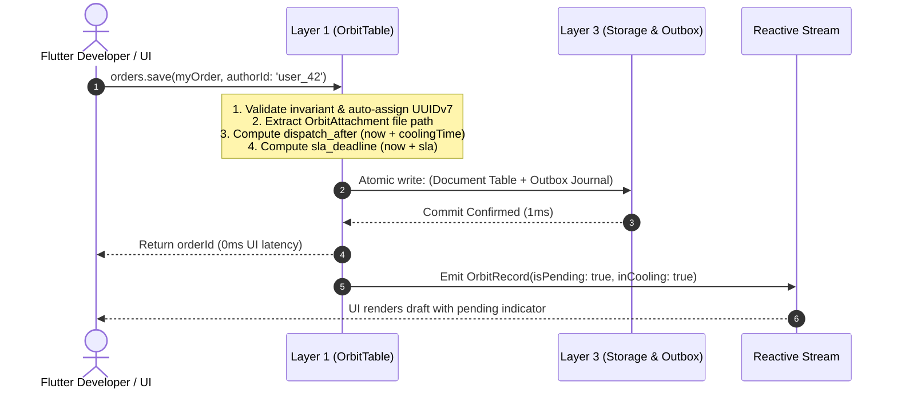

# 🛰️ Orbit Architecture Blueprint — Layer 1: Developer Facade

> **Status:** APPROVED & LOCKED  
> **Target Package:** `orbit_sync`  
> **Role:** Host Developer API & Declarative Contract  
> **Philosophy:** Zero-SQL, Zero-DDL, Pure Document Store (JSON-in, JSON-out)

---

## 1. Executive Summary & Ideology

Layer 1 is the **sole entry point and configuration surface** for the host application developer. 
The host developer never writes SQL queries, never manages SQLite schema migrations, and never handles HTTP retry loops.

### The 4 Foundational Guarantees of Layer 1:
1. **Single-Touchpoint Configuration**: The developer configures the engine once at startup via declarative options.
2. **Zero-DDL Document Store**: All data enters as Dart models and exits as Dart models. SQLite stores them internally as JSON documents.
3. **0ms Write Latency**: Local writes (`save`, `delete`) commit instantly to SQLite WAL. The user interface never blocks on a network spinner.
4. **Declarative Business Rules**: SLAs, local cooling-off windows, priorities, and media uploads are declared in 1 line without custom sync code.

---

## 2. The Configuration Contract (`OrbitClient.initialize` & `collection<T>`)

### A. Root Engine Initialization
Configures backend connectivity, authentication, and root lifecycle hooks:

```dart
final orbit = await OrbitClient.initialize(
  baseUrl: 'https://api.myenterprise.com/v1',
  userId: 'usr_9842', // User ID for folder-isolated storage: users/usr_9842/orbit.db
  getAuthToken: () async => await authVault.getAccessToken(),
  
  // Optional root overrides:
  onAuthExpired: () async => await authVault.refreshAccessToken(),
  onLog: (msg) => debugPrint('[Orbit] $msg'),
);

// Switch user on shared tablets without deleting offline data:
await orbit.switchUser('usr_5130');
```

### B. Declarative Collection Definition
Configures an entity, its REST mapping, and its business rules:

```dart
final orders = orbit.collection<Order>(
  name: 'orders',
  
  // 1. REST Routing (Defaults to '/$name' if omitted)
  endpoint: '/orders',

  // 2. Business Rules (Declarative & Optional)
  priority: Priority.high,                 // Critical, High, Normal, Background
  sla: const Duration(hours: 2),           // Business SLA deadline
  coolingTime: const Duration(minutes: 5), // Local grace period before network dispatch

  // 3. Media Handling (Optional)
  media: MediaConfig(
    mode: MediaMode.twoStep,               // multipart OR twoStep
    uploadEndpoint: '/orders/{id}/receipt',
  ),

  // 4. Pure Dart JSON Mappers
  fromJson: Order.fromJson,
  toJson: (order) => order.toJson(),
);
```

---

## 3. The 4 Developer Operations (API Surface)

```
┌────────────────────────────────────────────────────────┐
│               LAYER 1 CORE OPERATIONS                  │
│                                                        │
│  orders.save(item)          orders.delete(id)          │
│  (0ms Local Write)          (Undoable Tombstone)       │
│                                                        │
│  orders.watch(filter: ...)  orders.watchRecords(...)   │
│  (Pure Dart Predicates)     (Sync Status & 422 Errors) │
└────────────────────────────────────────────────────────┘
```

### 1. `save(T item, {String? authorId})`
* **Behavior**:
  * Inspects `item.id`, `json['id']`, or `json['_id']`. If null, auto-generates a universal **UUIDv7**.
  * Inspects model for `OrbitAttachment` metadata and extracts local file paths.
  * Stamps audit metadata (`authorId`, `created_at`, `device_id`).
  * Hands off to Layer 3 (Storage) in a single atomic transaction.
* **Latency**: 0ms local return. Never awaits network.

### 2. `delete(String id, {String? authorId})`
* **Behavior**:
  * Marks the record as deleted locally.
  * If `coolingTime` is active, the delete mutation is held locally.
* **Undoable**: The developer can call `orders.undoDelete(id)` during the cooling window to restore the record before network dispatch.

### 3. `watch({bool Function(T item)? filter, int? limit, int? offset})`
* **Behavior**:
  * Returns a real-time reactive `Stream<List<T>>` of pure Dart objects.
  * **Zero SQL strings**: Filters are written using pure Dart predicates.
  * **Built-in Pagination**: Supports `limit` and `offset` to prevent memory bloat on large datasets:
    ```dart
    orders.watch(
      limit: 25,
      offset: 0,
      filter: (o) => o.status == 'active',
    );
    ```
  * Automatically re-emits when local edits occur or remote changes are pulled.

### 4. `query({bool Function(T item)? filter, int? limit, int? offset})`
* **Behavior**:
  * One-shot asynchronous local read returning `Future<List<T>>`.
  * Evaluates directly against local SQLite WAL with optional `limit` and `offset`.

### 5. `watchRecords({bool Function(OrbitRecord<T> record)? filter, int? limit, int? offset})`
* **Behavior**:
  * Provides access to the sync status lifecycle for UI state management.
  * `OrbitRecord<T>` exposes:
    * `record.data`: The Dart model.
    * `record.isPending`: True if waiting in queue or inside cooling window.
    * `record.isSynced`: True if confirmed by the remote server (HTTP 200).
    * `record.isRejected`: True if server returned HTTP 422 (validation error).
    * `record.errorMessage`: Server error message for display in UI error banners.

---

## 4. Media & Attachment Handling Protocol

To prevent mobile memory bloat and SQLite corruption, heavy binary files (photos, camera captures, PDFs, signatures) are **never stored as raw bytes in SQLite**.

### The `OrbitAttachment` Metadata Pattern
```dart
class Payment {
  final String? id;
  final double amount;
  final OrbitAttachment receipt;

  Payment({this.id, required this.amount, required this.receipt});
}
```

Stored inside `data_json` as lightweight metadata:
```json
{
  "amount": 250.0,
  "receipt": {
    "type": "orbit_attachment",
    "local_path": "/var/mobile/containers/receipt_101.jpg",
    "mime_type": "image/jpeg",
    "file_name": "receipt_101.jpg",
    "field_name": "receipt"
  }
}
```

### The 2 Supported Media Modes:
1. **`MediaMode.multipart` (Unified Request)**:
   Sends the JSON fields + the binary file from disk in a single `multipart/form-data` request.
2. **`MediaMode.twoStep` (Parent-Child Upload)**:
   * **Step 1**: Syncs lightweight JSON document first (`POST /payments`) ➔ receives server ID `srv_505`.
   * **Step 2**: Streams binary file to child route (`POST /payments/srv_505/receipt`).

---

## 5. Enterprise Business Rules Engine in Layer 1

### A. The Cooling-Off Window (`coolingTime`)
* **Definition**: A local hold window before network dispatch.
* **Workflow**:
  1. User creates or edits a record offline.
  2. The mutation stays in the local outbox with `status = 'pending'` and `dispatch_after = now + coolingTime`.
  3. During this period, subsequent edits update the pending mutation locally with **zero network traffic**.
  4. Once `coolingTime` expires, Orbit unlocks the mutation for network transmission.

### B. Business SLA Deadlines (`sla`)
* **Definition**: The maximum permitted offline latency before a business breach is flagged.
* **Workflow**:
  1. Mutation is stamped with `sla_seconds`.
  2. If the device remains offline and reaches 80% of SLA, Orbit emits an `SlaWarningEvent`.
  3. If SLA is breached, Orbit emits an `SlaBreachEvent` for manager alerts.

### C. Priority Tiers (`priority`)
* `Priority.critical`: Bypasses FIFO queues, dispatches first (e.g. Payments, Incident Reports).
* `Priority.high`: Expedited queue.
* `Priority.normal`: Default business actions.
* `Priority.background`: Telemetry, analytics, and non-blocking syncs.

---

## 6. End-to-End Layer 1 Sequence Diagram



---

## 7. What Layer 1 Explicitly DOES NOT Do (Layer Boundaries)

* ❌ **Never writes raw SQLite SQL queries or DDL strings.**
* ❌ **Never manages HTTP sockets, connection pools, or TLS certificates.**
* ❌ **Never implements host app user roles or RBAC.**
* ❌ **Never runs network retry backoff calculations directly.**

All downstream work is handed off cleanly to **Layer 3 (Storage)** and **Layer 5 (Consensus Engine)**.
