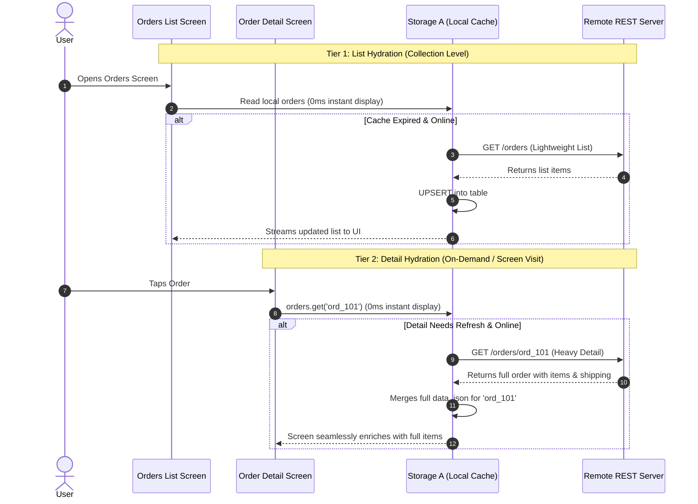

# 🛰️ Orbit Architecture Blueprint — Layer 3: Storage A (Local Read Cache)

> **Status:** APPROVED & LOCKED  
> **Target Package:** `orbit_sync`  
> **Role:** Ephemeral Local Document Cache (Server Mirror)  
> **Philosophy:** High-Speed 0ms Reads, Zero-JOIN Nested JSON, Non-Destructive Invalidation

---

## 1. Executive Summary & Core Purpose

**Storage A** is the local read-side database of Orbit's CQRS architecture. It acts as an **ephemeral, high-speed mirror of the remote server**.

### The 4 Foundational Guarantees of Storage A:
1. **0ms Read Latency**: All UI queries (`watch`, `get`, `query`) read locally from SQLite WAL in sub-millisecond time. Zero network spinners for viewing cached data.
2. **Zero-JOIN Nested Document Model**: Entire complex trees (e.g. Orders + Line Items + Shipping Address) live inside one row in `data_json`. No complex relational SQL `JOIN`s.
3. **Non-Destructive Invalidation ("Never Purge in the Dark")**: If cache TTL expires while offline, data is **never deleted**. It remains visible as `isStale: true`. Eviction occurs **only after** fresh data is successfully confirmed from the network.
4. **Outbox Protection Invariant**: Records with pending un-synced user mutations in Storage B are **strictly immune** from cache eviction or purging.

---

## 2. The Universal Document Table Schema

Every domain entity registered in Orbit (`orders`, `customers`, `products`, `invoices`) uses **one single, unified schema**:

```sql
CREATE TABLE "$entityName" (
  "id" TEXT PRIMARY KEY,          -- Document ID (Server ID or local UUIDv7)
  "version" INTEGER DEFAULT 1,    -- Concurrency version from server (Optimistic Lock)
  "updated_at" INTEGER NOT NULL,  -- Timestamp when row was cached locally
  "expires_at" INTEGER,           -- Millisecond timestamp when cache TTL expires
  "data_json" TEXT NOT NULL       -- THE SINGLE SOURCE OF TRUTH (Full JSON Document)
);
```

### Architectural Cleanup from Legacy Version:
* ❌ **Removed `_base_snapshot_json`**: Domain tables only store the *current* state. Snapshots belong strictly inside Storage B (Outbox).
* ❌ **Removed `$fullCols` (Dynamic Columns)**: No physical columns for `title`, `total`, etc. This eliminates schema drift and migration crashes.
* ✅ **`data_json` is the sole source of truth**.

---

## 3. High-Performance Indexing Strategy

Storage A maintains two internal system indexes per entity to keep reads and evictions fast:

### 1. Reverse Recency Index (Fast Sorting & Listing)
```sql
CREATE INDEX IF NOT EXISTS idx_${entity}_updated 
ON "$entity"(updated_at DESC);
```

### 2. Partial TTL Eviction Index (Zero-Cost Scans)
```sql
CREATE INDEX IF NOT EXISTS idx_${entity}_expires 
ON "$entity"(expires_at) 
WHERE expires_at IS NOT NULL;
```
*(Only indexes rows with a finite TTL, keeping index size tiny).*

### 3. Native JSON Expression Indexes (Optional High-Frequency Filters)
For enterprise fields queried frequently (e.g., `status` or `shipping.city`), SQLite indexes directly into the JSON document:
```sql
CREATE INDEX IF NOT EXISTS idx_${entity}_status 
ON "$entity"(json_extract(data_json, '$.status'));
```

### 4. High-Speed Local Pagination (`LIMIT ? OFFSET ?`)
To prevent mobile UI stutter and Out-Of-Memory (OOM) crashes when tables contain 10,000+ cached rows:
```sql
SELECT data_json FROM "$entity" 
ORDER BY updated_at DESC 
LIMIT :limit OFFSET :offset;
```
* Queries only load the requested window into Dart memory.
* If a Dart predicate filter is passed, filtering is streamed lazily up to the `limit`.

---

## 4. Two-Tier Smart Hydration (List vs. Detail Lazy Loading)

To prevent wasting cellular bandwidth and device RAM on massive enterprise datasets, Storage A implements **Two-Tier Hydration**:



### Tier 1: Collection / List Level
* Calls `GET /orders` when the list screen opens or when collection `cacheTtl` has expired.
* Stores lightweight summary records. Does not download heavy nested details for 1,000 orders at once.

### Tier 2: Detail Level (Lazy Enrichment)
* When the user taps a record, `orders.get('ord_101')` returns the local cache instantly (0ms).
* If full details are missing or stale, Orbit fetches `GET /orders/ord_101` in the background and enriches `data_json`.

---

## 5. Cache Invalidation & The "Never Purge in the Dark" Rule

### The Problem:
If a user is offline and their 12-hour TTL expires, hard-deleting the cache leaves them with a **completely blank screen** and no way to re-download.

### The Rule (Network-Gated Invalidation):
1. **Offline + TTL Expired**:
   * Storage A **never deletes** the record.
   * Data remains fully readable and queryable.
   * UI streams flag the record with `isStale: true`.
2. **Online + TTL Expired**:
   * Device connects to internet.
   * Orbit calls `GET /orders`.
   * **Only after HTTP 200 OK arrives** does Orbit update or replace the stale cache!
   * If the network call fails (e.g. server 500 error), the existing cache remains intact.

### The Purge Query (Guarded by Outbox):
```sql
DELETE FROM "$entityName" 
WHERE expires_at IS NOT NULL 
  AND expires_at <= ? 
  -- SAFETY INVARIANT: Never purge records with pending user edits!
  AND id NOT IN (
    SELECT entity_id FROM _sync_outbox WHERE entity_name = '$entityName'
  );
```

---

## 6. Non-Destructive Offline Refresh Protocol

When a user pulls down to refresh while offline, **Orbit provides the signal, but the host app paints the pixels**.

```
[ User pulls to refresh while offline ]
                 │
                 ▼
     orders.refresh() called
                 │
                 ▼
┌────────────────────────────────────────────────────────┐
│                   ORBIT ENGINE                         │
│                                                        │
│  1. Connectivity check: Device is offline              │
│  2. Safety Guarantee: Zero rows deleted from cache     │
│  3. Returns typed result: RefreshResult.offline        │
└────────────────────────┬───────────────────────────────┘
                         │
                         ▼
┌────────────────────────────────────────────────────────┐
│                   HOST APP UI LAYER                    │
│                                                        │
│  • Reads result.isOffline                              │
│  • Stops pull-to-refresh spinner immediately           │
│  • Displays branded notification:                      │
│    "No internet connection. Displaying offline data."  │
└────────────────────────────────────────────────────────┘
```

---

## 7. Advanced Enterprise Rules for Storage A

### A. Offline Pinning (`is_pinned`)
* Field technicians can pin critical jobs before entering zero-signal zones: `orders.pin('ord_101')`.
* Pinned records set `expires_at = NULL` and are **immune** to TTL expiration and quota pruning.

### B. Storage Quotas & LRU Eviction (Least Recently Used)
* Prevents enterprise catalogs (e.g. 100,000 items) from exhausting device disk storage.
* Developer configures `maxCacheRecords: 2000`.
* When limit is exceeded, Orbit prunes the oldest records by `updated_at`.
* *Invariant*: Never prunes pinned records or records with pending outbox mutations.

### C. JSON Delta Patching (RFC 7396)
* When receiving a partial server change (e.g. WebSocket update: `{ "status": "shipped" }`):
* Orbit executes a native SQLite JSON patch:
  ```sql
  UPDATE "$entityName" 
  SET data_json = json_patch(data_json, ?), updated_at = ? 
  WHERE id = ?;
  ```
* Updates single fields in sub-milliseconds without re-downloading large documents.

### D. Territory & Scope Eviction (Multi-Tenant)
* When a user changes warehouse or sales route: `orbit.setScope({'store_id': 'S-102'})`.
* Orbit drops cached items outside the active scope while preserving pending outbox records.

---

## 8. Summary of Storage A Guarantees

| Property | Rule |
| :--- | :--- |
| **Physical Schema** | Only 5 columns: `id`, `version`, `updated_at`, `expires_at`, `data_json`. |
| **Write Model** | Bulk `INSERT OR REPLACE` during server pull/hydration. |
| **Query Model** | Fast O(1) primary key lookups or Dart in-memory predicate filtering. |
| **Durability** | Ephemeral server mirror. Safe to rebuild on HTTP 410 (Gone). |
| **Offline Resilience** | Never purges expired data while disconnected. |
