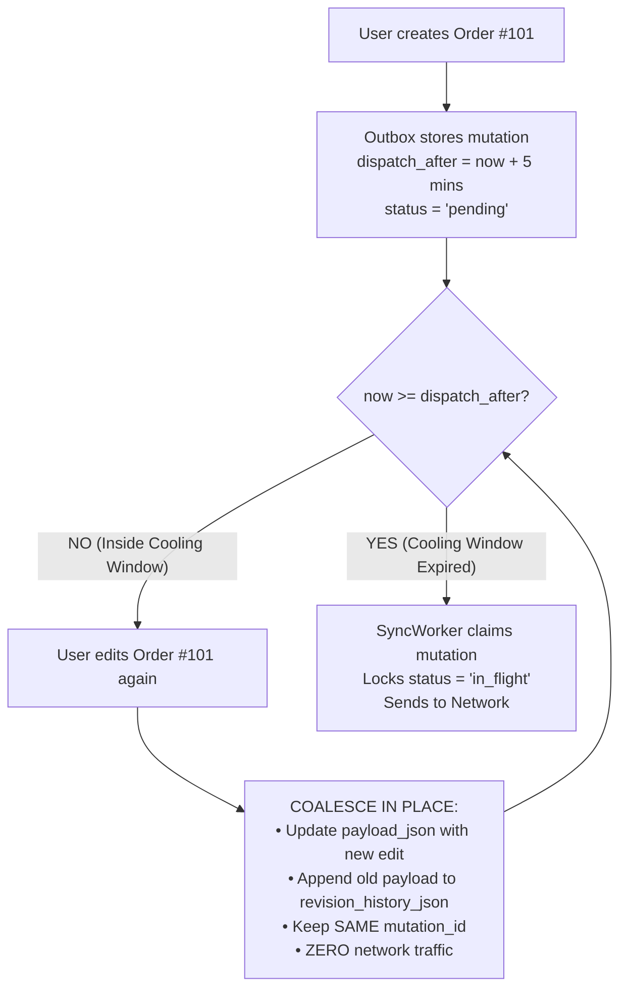

# 🛰️ Orbit Architecture Blueprint — Layer 3: Storage B (The Action Journal / Outbox)

> **Status:** APPROVED & LOCKED  
> **Target Package:** `orbit_sync`  
> **Role:** The Sacred Human Intent Ledger (`_sync_outbox`)  
> **Philosophy:** Indestructible, Append-Only, Priority-Ordered, SLA-Aware

---

## 1. Executive Summary & Core Purpose

**Storage B (`_sync_outbox`)** is the write-side journal of Orbit's CQRS architecture. 

While Storage A (The Cache) is disposable and mirrors the server, **Storage B is sacred**:
* It records every create, update, and delete initiated by the human user.
* **The Core Invariant**: An un-synced user mutation is **indestructible**. It can never be silently dropped, purged by cache cleaners, or destroyed by server errors (HTTP 422).
* It enforces business deadlines (SLAs), local cooling-off windows, and priority dispatching.

---

## 2. The Refined `_sync_outbox` Schema

```sql
CREATE TABLE _sync_outbox (
  sequence_id INTEGER PRIMARY KEY AUTOINCREMENT, -- Strict local chronological order
  mutation_id TEXT UNIQUE NOT NULL,              -- Universal UUIDv7 (time-ordered)
  entity_name TEXT NOT NULL,                     -- e.g. 'orders', 'payments'
  entity_id TEXT NOT NULL,                       -- Document ID
  op TEXT NOT NULL,                              -- 'create', 'update', 'delete'
  endpoint_url TEXT,                             -- Target REST URL
  http_method TEXT,                              -- 'POST', 'PUT', 'PATCH', 'DELETE'
  payload_json TEXT NOT NULL,                    -- The user's JSON document write
  base_snapshot_json TEXT,                       -- Baseline snapshot for 3-way merge
  base_version INTEGER NOT NULL DEFAULT 1,       -- Concurrency version when edited
  status TEXT NOT NULL DEFAULT 'pending' CHECK (
    status IN ('pending', 'in_flight', 'synced', 'failed', 'dlq', 'held', 'conflict', 'validation_error')
  ),
  
  -- ENTERPRISE AUDIT & ATTRIBUTION FIELDS:
  author_id TEXT,                                 -- Who made the change (for local audit dashboard)
  user_id TEXT,                                   -- Token owner (multi-user shared device safety)
  media_path TEXT,                                -- Local binary file path for attachments

  -- CAUSALITY & BUSINESS RULES:
  depends_on_mutation_id TEXT,                   -- DAG parent link (child waits for parent)
  correlation_tag TEXT,                          -- Distributed tracing ID
  priority INTEGER NOT NULL DEFAULT 1 CHECK (
    priority BETWEEN 0 AND 3                      -- 0: Background, 1: Normal, 2: High, 3: Critical
  ),
  sla_seconds INTEGER DEFAULT 86400 CHECK (sla_seconds >= 0), -- Business sync deadline
  schema_version INTEGER NOT NULL DEFAULT 1,
  
  -- LIFECYCLE & RETRY TRACKING:
  error_details_json TEXT,                       -- Server rejection details (HTTP 422/400)
  dispatch_after INTEGER,                        -- Cooling-off window deadline (ms timestamp)
  revision_history_json TEXT,                    -- Local edit history during cooling window
  headers_json TEXT,                             -- Entity-specific HTTP headers
  retry_count INTEGER NOT NULL DEFAULT 0 CHECK (retry_count >= 0),
  next_retry_at INTEGER,                         -- Exponential backoff timestamp
  created_at INTEGER NOT NULL,                   -- Creation timestamp
  updated_at INTEGER NOT NULL DEFAULT 0          -- Last state change timestamp
);
```

---

## 3. High-Performance Queue Indexes

To process millions of outbox transactions with sub-millisecond query times, Storage B maintains 4 specialized B-tree indexes:

### 1. Active Queue Dispatch Index
Powers `pushBatch()` candidate selection in exact priority and sequence order:
```sql
CREATE INDEX IF NOT EXISTS idx_sync_outbox_queue 
ON _sync_outbox(status, dispatch_after, next_retry_at, priority DESC, sequence_id ASC);
```

### 2. SLA Countdown Index
Powers `SlaMonitor` scans to detect near-breach and breached deadlines:
```sql
CREATE INDEX IF NOT EXISTS idx_sync_outbox_sla 
ON _sync_outbox(status, (created_at + sla_seconds * 1000) ASC, priority DESC);
```

### 3. DAG Parent-Child Dependency Index
Instant resolution of held child mutations when a parent syncs:
```sql
CREATE INDEX IF NOT EXISTS idx_sync_outbox_deps 
ON _sync_outbox(depends_on_mutation_id);
```

### 4. Entity Lifecycle Index
Powers `watchRecords()` and single-item status tracking:
```sql
CREATE INDEX IF NOT EXISTS idx_sync_outbox_entity 
ON _sync_outbox(entity_name, entity_id, status);
```

---

## 4. Priority vs. SLA: Importance vs. Urgency

In real-world enterprise apps, **Priority** and **SLA** are fundamentally different dimensions:
* **Priority (`priority`)**: Static business importance (e.g. Critical POS Payment vs. Normal Inventory Update).
* **SLA (`sla_seconds`)**: Dynamic countdown clock until contract breach (e.g. 15-minute gate pass vs. 24-hour purchase order).

### The Emergency Escalation Dispatch Rule
A lower-priority action with an urgent deadline must **never starve** behind a high-priority action that has 20 hours to spare.

When the sync worker claims candidate mutations, it applies **Hybrid Earliest-Deadline-First (EDF)** scheduling:
```sql
SELECT * FROM _sync_outbox 
WHERE status = 'pending' 
  AND (dispatch_after IS NULL OR dispatch_after <= :now)
  AND (next_retry_at IS NULL OR next_retry_at <= :now)
ORDER BY 
  -- 1. EMERGENCY SLA ESCALATION: Items with < 15 mins remaining jump to the front!
  CASE 
    WHEN (created_at + sla_seconds * 1000) - :now < 900000 THEN 1 
    ELSE 0 
  END DESC,
  
  -- 2. BUSINESS PRIORITY TIER: (Critical > High > Normal > Background)
  priority DESC,
  
  -- 3. EARLIEST DEADLINE FIRST: Within the same tier, tighter SLA goes first
  (created_at + sla_seconds * 1000) ASC,
  
  -- 4. FIFO Sequence fallback
  sequence_id ASC
LIMIT :batchSize;
```

---

## 5. The Cooling-Off Window Mechanics (`dispatch_after`)

When `coolingTime` is configured (e.g., 5 minutes):



### Undo During Cooling Window:
If the user deletes an order and taps "Undo" during the cooling window:
* Orbit executes `orders.undoDelete('ord_101')`.
* The pending delete mutation is canceled locally. **Zero network packets are ever sent.**

---

## 5. Multi-User Safety on Shared Devices (Folder Isolation by `userId`)

In field service, tablets are often shared between shifts:
* **The Folder-Based Storage Architecture**:
  Instead of sharing a single SQLite file and risking data leaks or accidental purges, Orbit uses **dedicated directory isolation** keyed by `userId`:
  ```
  /data/user/0/com.app/databases/orbit/
    ├── users/
    │   ├── usr_9842/                  <-- Dedicated folder for User ID 9842
    │   │   ├── orbit.db               <-- Their SQLite database
    │   │   ├── orbit.db-wal           <-- WAL journal
    │   │   └── orbit.db-shm           <-- Shared memory index
    │   └── usr_5130/                  <-- Dedicated folder for User ID 5130
    │       ├── orbit.db
    │       ├── orbit.db-wal
    │       └── orbit.db-shm
    └── guest/                         <-- Pre-login or fallback
        └── orbit.db
  ```
* **Zero Data Loss on Logout / Switch**:
  * Agent John (User ID `usr_9842`) works offline all day and creates 5 orders without syncing.
  * Agent Sarah (User ID `usr_5130`) logs in. Orbit closes `users/usr_9842/orbit.db` and opens `users/usr_5130/orbit.db`.
  * **Zero rows are wiped**.
  * When Agent John logs back in tomorrow, Orbit re-opens `users/usr_9842/orbit.db`. **All 5 un-synced orders and drafts are 100% intact**, ready to sync.
* **`author_id` (Audit Attribution)**:
  * Records the human name or badge ID for UI display: *"Order #101 created by Agent John"*.
  * Independent of directory isolation.

---

## 6. The Outsider Boundary: No Synthetic Foreign-Key Rewriting

As an outsider universal sync plugin:
* Orbit does **not** invent artificial client IDs or attempt regex replacements across nested JSON foreign keys (e.g. replacing `temp_cust_1` with `srv_cust_99` inside order payloads).
* Orbit stores and syncs the exact data models provided by the host app.
* If a business operation requires a server ID, the host app provides it or waits for online creation. Orbit does not simulate an ERP relational engine.

---

## 7. Configurable Synced Outbox Retention & Pruning

Once a mutation reaches `status = 'synced'`, how long should it remain in SQLite?

### The Retention Policy:
* **Default Retention**: **7 Days** (`Duration(days: 7)`).
  * Keeps recent synced transactions available for the local Sync Center / History screen.
* **Developer Configurable**:
  * The host app can configure `syncedRetention: Duration(days: 1)` or any custom duration.
* **The Background Prune Query**:
  ```sql
  DELETE FROM _sync_outbox 
  WHERE status = 'synced' 
    AND updated_at < ?; -- (nowMs - retentionMs)
  ```
  *(Never touches `pending`, `in_flight`, `dlq`, or `validation_error` records).*

---

## 8. The 8 States of the Outbox Finite State Machine

```
┌────────────────────────────────────────────────────────────────────────┐
│                        OUTBOX MUTATION STATES                          │
│                                                                        │
│  • pending          Waiting for cooling time or network dispatch       │
│  • in_flight        Currently locked by a sync worker                  │
│  • synced           Successfully confirmed by server (HTTP 200/201)    │
│  • held             Blocked because parent mutation hasn't synced      │
│  • validation_error Server returned HTTP 422; draft preserved for edit │
│  • conflict         Server returned HTTP 409; queued for 3-way merge   │
│  • dlq              Max retries exhausted; quarantined for review      │
│  • failed           Non-retryable client-side error                    │
└────────────────────────────────────────────────────────────────────────┘
```

---

## 9. Summary of Storage B Guarantees

| Property | Rule |
| :--- | :--- |
| **Durability** | **Sacred ledger.** Never deleted on network drops, crashes, or 422 errors. |
| **Ordering** | FIFO within priority tiers; strict DAG parent-before-child ordering. |
| **Cooling-Off** | Edits inside `dispatch_after` coalesce into `revision_history_json` with zero network overhead. |
| **Pruning** | Synced records retained for **7 days by default** (configurable), then safely purged. |
| **Shared Tablets** | Guarded by `user_id` to prevent cross-session token pollution. |
