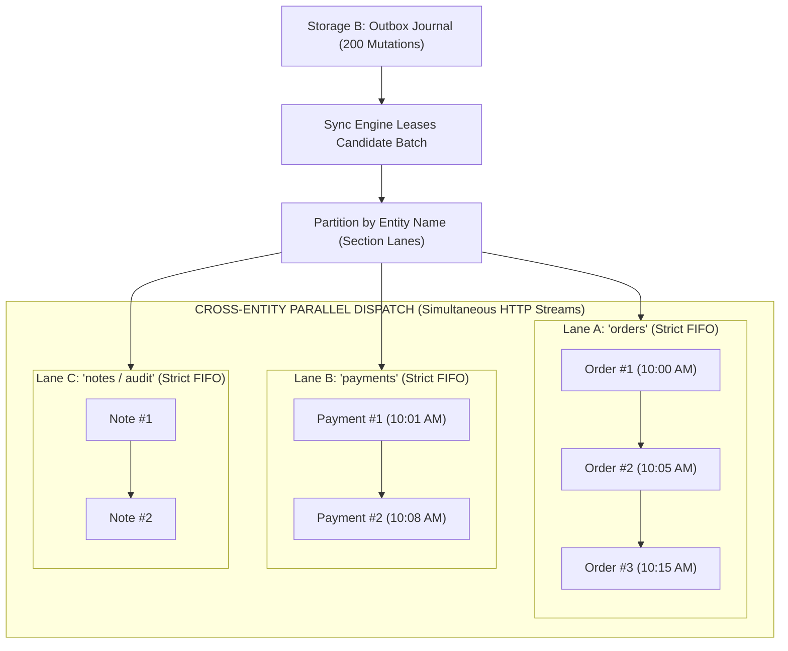
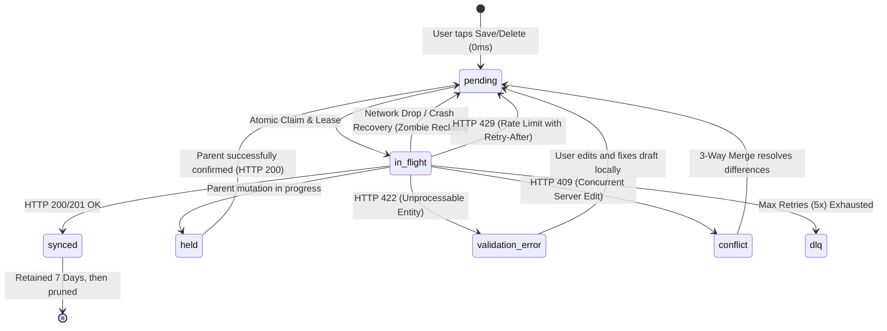
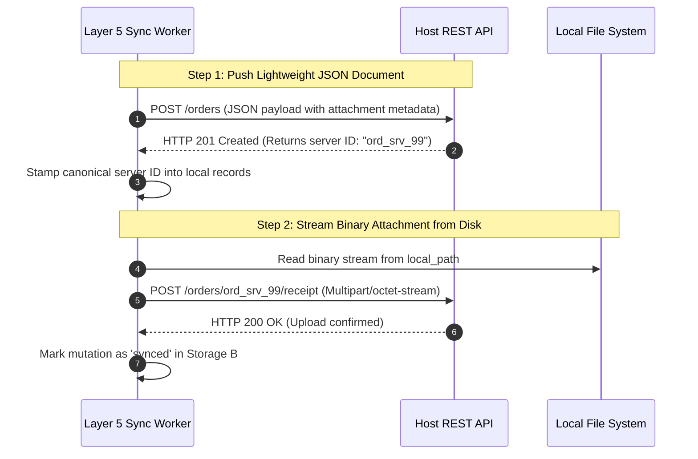

# 🛰️ Orbit Architecture Blueprint — Layer 5: Consensus & Sync Engine

> **Status:** APPROVED & LOCKED  
> **Target Package:** `orbit_sync`  
> **Role:** The Intelligent Dispatcher & Conflict Arbiter (The Middleman)  
> **Philosophy:** High-Speed Parallel Concurrency, Strict Parent-Child Causality, Zero Data Loss

---

## 1. Executive Summary & Core Responsibilities

**Layer 5 (The Consensus Engine)** is the brain between **Storage B (The Outbox Journal)** and **Layer 6 (HTTP Transport)**.

Its primary goal is to **drain Storage B into the host backend as fast as possible** with **maximum reliability and minimum failure**:
1. **Parallel High-Speed Dispatch**: Dispatches independent mutations simultaneously across an HTTP connection pool to maximize throughput.
2. **Strict Parent-Child Sequential Order**: Ensures dependent mutations (e.g. Order Header ➔ Payment or Document ➔ Photo Attachment) execute in strict sequential order.
3. **Atomic State Leasing**: Guarantees zero lost mutations and zero duplicate submissions via atomic SQLite `writeTransaction` locks.
4. **Resilient Error Classification**: Intelligently handles HTTP status codes (`401`, `422`, `429`, `5xx`) without blocking healthy queue items.
5. **Universal REST Compatibility**: Connects to ANY standard REST backend (Django, Laravel, NestJS, Spring Boot, Go) without requiring backend rewrites.

---

## 2. Multi-Lane Concurrency: Cross-Entity Parallelism + Intra-Entity FIFO

To combine maximum speed with enterprise safety, Layer 5 enforces **Section-Level (Entity-Keyed) Concurrency**:



### The Three Concurrency & Ordering Rules:

1. **Intra-Entity Strict FIFO (Why Orders must never be parallelized with Orders)**:
   * **Preserves Sequential Invoice Numbers**: Prevents Order #2 from arriving 50ms before Order #1, which would scramble backend invoice serial numbers (`INV-001` vs `INV-002`).
   * **Preserves Fair FIFO Stock Allocation**: If only 1 item remains in inventory, the customer who bought it first offline gets it first.
   * **Prevents Server DB Deadlocks**: Eliminates race-condition row locks on the backend database when updating identical inventory records.
   * *Rule*: Within the same entity (e.g. `orders`), mutations are processed in strict `sequence_id ASC` order.

2. **Cross-Entity Parallelism (High Speed)**:
   * Independent business sections (`orders`, `payments`, `notes`, `customers`) execute in **parallel lanes** across an HTTP connection pool (`maxConcurrentLanes: 3..6`).
   * The `payments` lane does not wait for 50 `orders` to finish syncing.
   * High-priority sections and sections with nearing SLA deadlines run first.

3. **Parent-Child Causality (`depends_on_mutation_id`)**:
   * If a Payment or Binary Attachment strictly depends on an Order header:
   * The child mutation remains locked in `status = 'held'` until the parent returns HTTP `200/201 Created` with a canonical server ID.
   * Once the parent completes, the child is automatically unlocked to `pending` in its lane.

---

## 3. Atomic Outbox Leasing & The State Machine

To prevent duplicate requests and recover seamlessly from app crashes:



### Crash Recovery: The Zombie Lease Reclaimer
If the host app is killed or loses power while a mutation is `in_flight`:
* Upon startup and before each sync cycle, Orbit executes:
  ```sql
  UPDATE _sync_outbox 
  SET status = 'pending' 
  WHERE status = 'in_flight' 
    AND updated_at < :now - 60000; -- Older than 60 seconds
  ```
* This ensures no mutation is ever frozen or orphaned in SQLite.

---

## 4. Priority & SLA Hybrid EDF Dispatch Algorithm

Layer 5 pulls mutations from Storage B using a **Hybrid Earliest-Deadline-First (EDF)** selector:

```sql
SELECT * FROM _sync_outbox 
WHERE status = 'pending' 
  AND (dispatch_after IS NULL OR dispatch_after <= :now)
  AND (next_retry_at IS NULL OR next_retry_at <= :now)
ORDER BY 
  -- 1. EMERGENCY SLA ESCALATION: Items with < 15 mins remaining jump the queue!
  CASE 
    WHEN (created_at + (sla_seconds * 1000)) - :now < 900000 THEN 1 
    ELSE 0 
  END DESC,

  -- 2. BUSINESS PRIORITY TIER: (Critical: 3 > High: 2 > Normal: 1 > Background: 0)
  priority DESC,

  -- 3. EARLIEST DEADLINE FIRST: Within the same tier, tighter SLA goes first
  (created_at + (sla_seconds * 1000)) ASC,

  -- 4. FIFO Sequence fallback
  sequence_id ASC
LIMIT :batchSize;
```

---

## 5. Resilient HTTP Wire Error Handling (Standard REST)

Layer 5 maps every REST response into an intelligent recovery action:

| HTTP Status | Interpretation | Engine Action |
| :--- | :--- | :--- |
| **`200 / 201`** | **Success** | Mark `status = 'synced'`. Unlock dependent children from `held` ➔ `pending`. |
| **`401`** | **Token Expired** | Return all leased items to `pending`. Await `onAuthExpired()` token refresh, then resume. |
| **`422`** | **Validation Error** | **Never drop data.** Mark `status = 'validation_error'`, roll back optimistic cache, and preserve the user's draft for manual editing. |
| **`429`** | **Rate Limited** | Parse RFC 7231 `Retry-After` header. Set `next_retry_at = now + retryAfter`. Return lease to `pending`. |
| **`409`** | **Conflict** | Trigger `ConflictReconciler` (3-Way Merge). If resolved, update payload and push; if invariant violated, flag for user review. |
| **`5xx / Network`** | **Transient Failure** | Increment `retry_count`. Schedule exponential backoff delay (`2s`, `4s`, `8s`... + jitter). If retries exceed limit (5x), move to `dlq`. |

---

## 6. Two-Step Media Attachment Upload Pipeline

When an entity includes an `OrbitAttachment` (e.g. photo, signature, PDF):



* SQLite **never** loads raw photo bytes into memory.
* The binary is streamed straight from the device disk to the network.

---

## 7. Universal 5-Column Remote Change Ingestion

When pulling remote server changes (`GET /changelog` or SSE/WebSocket streams):
* **Abolished**: No dynamic schema alterations (`ALTER TABLE ADD COLUMN`).
* **Abolished**: No `_base_snapshot_json` in domain tables.
* **The Universal Ingestion Query**:
  ```sql
  INSERT INTO "$entity" (id, version, updated_at, expires_at, data_json)
  VALUES (:id, :version, :now, :expiresAt, :dataJson)
  ON CONFLICT(id) DO UPDATE SET
    version = excluded.version,
    updated_at = excluded.updated_at,
    expires_at = excluded.expires_at,
    data_json = excluded.data_json;
  ```

---

## 8. Summary of Layer 5 Guarantees

| Guarantee | Rule |
| :--- | :--- |
| **Speed** | Independent mutations dispatch across **parallel HTTP streams**. |
| **Safety** | Parent-child dependencies and same-entity mutations run in **strict sequential causality**. |
| **Reliability** | Atomic SQLite leasing (`writeTransaction`) + 60s zombie crash recovery. |
| **Data Safety** | Server HTTP 422 errors **preserve user drafts** instead of deleting them. |
| **Agnostic** | Works with standard REST backends without any custom server plugins. |
