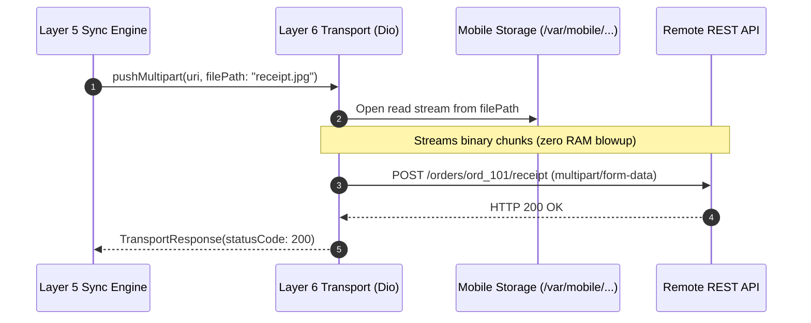

# 🛰️ Orbit Architecture Blueprint — Layer 6: Transport & Wire Execution

> **Status:** APPROVED & LOCKED  
> **Target Package:** `orbit_sync`  
> **Role:** The Network Wire Layer (HTTP / REST / Multipart)  
> **Philosophy:** Dio as First-Class Engine, Zero Hardcoded Endpoints, Pure Developer Declarations, Zero Wire Pollution

---

## 1. Executive Summary & Core Responsibilities

**Layer 6 (The Transport Layer)** is the wire boundary between Orbit and the host app's backend.

Its foundational rules:
1. **Zero Hardcoded Endpoints**: Orbit contains **zero** hardcoded paths (no `/sync/pull` or `/sync/push`). All endpoints, paths, query parameters, and headers are declared by the host developer.
2. **`Dio` as the First-Class Default Engine**: Adopts the host app's pre-configured `Dio` instance to automatically inherit corporate SSL certificate pinning, OAuth2 interceptors, corporate VPN proxies, and logging.
3. **Zero Metadata Pollution**: Ensures internal tracking metadata (like `_sync_outbox`, `expires_at`, `retry_count`) is never sent to the backend. The backend receives clean, standard JSON.
4. **Disk-to-Wire Binary Multipart Streaming**: Streams file attachments (photos, PDFs, signatures) directly from device storage to the network without loading heavy bytes into RAM.
5. **Dynamic Runtime Headers & Queries**: Evaluates developer-provided callbacks right before each request to guarantee fresh auth tokens, tenant IDs, and branch parameters.

---

## 2. Declarative REST Configuration Contract (`RestEndpoint`)

To support **any backend** (Django, Laravel, Spring Boot, NestJS, Go) without guessing:

```dart
final orders = orbit.collection<Order>(
  name: 'orders',

  // 1. DECLARATIVE ENDPOINTS (Zero guessing, fully customizable)
  endpoint: RestEndpoint(
    path: '/api/v1/orders',                   // Standard base path
    
    // Optional overrides for non-standard backends:
    createPath: '/api/v1/orders/new',          // Optional custom POST
    updatePath: (id) => '/api/v1/orders/$id', // Optional custom PUT/PATCH
    deletePath: (id) => '/api/v1/orders/$id', // Optional custom DELETE
    detailPath: (id) => '/api/v1/orders/$id', // Optional custom GET
  ),

  // 2. DYNAMIC QUERY PARAMETERS (Evaluated at request time)
  queryParams: () => {
    'branch_id': authService.currentBranchId,
    'status': 'active',
  },

  // 3. COLLECTION-SPECIFIC HEADERS (Evaluated dynamically)
  headers: () async => {
    'X-Department': 'logistics',
    'X-Tenant-ID': authService.tenantId,
  },

  // 4. PURE DART MAPPERS
  fromJson: Order.fromJson,
  toJson: (o) => o.toJson(),
);
```

---

## 3. The `SyncTransport` Interface

The clean, decoupled abstraction powering all network interactions:

```dart
abstract interface class SyncTransport {
  /// 1. Standard REST CRUD Mutation (POST, PUT, PATCH, DELETE)
  Future<TransportResponse> pushJson({
    required Uri uri,
    required String method,
    Map<String, dynamic>? payload,
    Map<String, String>? headers,
    Duration? timeout,
  });

  /// 2. Binary Multipart Streaming (Photos, PDFs, Signatures)
  Future<TransportResponse> pushMultipart({
    required Uri uri,
    required String method,
    required String fieldName,
    required String filePath,
    required String fileName,
    required String mimeType,
    Map<String, String>? extraFields,
    Map<String, String>? headers,
    Duration? timeout,
  });

  /// 3. Standard REST GET for Two-Tier Hydration (List & Detail)
  Future<TransportResponse> fetch({
    required Uri uri,
    Map<String, String>? headers,
    Duration? timeout,
  });

  /// Releases underlying sockets / resources
  void dispose();
}
```

---

## 4. `Dio` as First-Class Default Engine (`DioHttpAdapter`)

In enterprise business apps, 95% of Flutter teams already have a configured `Dio` client. Orbit embraces this:

```dart
final orbit = await OrbitClient.initialize(
  // Pass the host app's existing Dio instance:
  dio: myHostAppDio, 
  baseUrl: 'https://api.mycompany.com',
  userId: 'usr_9842', // Folder-based isolation: databases/orbit/users/usr_9842/orbit.db
);
```

### Why Reusing Host `Dio` is Superior:
1. **OAuth2 Interceptors**: If a token expires, the host app's Dio interceptor refreshes it seamlessly.
2. **SSL Certificate Pinning**: Adheres strictly to the company's enterprise security policies.
3. **Corporate Proxy & VPN**: Automatically routes through the company's proxy settings without custom code.
4. **Fallback & Testing**:
   * If `dio` is omitted, Orbit creates an internal `Dio` instance with default timeouts.
   * `DefaultHttpAdapter` (`package:http`) is preserved as a lightweight secondary option.
   * `InMemorySyncTransport` is provided for fast, socket-free unit testing.

---

## 5. Binary Attachment Streaming (`pushMultipart`)

When an entity includes an `OrbitAttachment` (e.g. camera photo, delivery signature):



### Protection Against Mobile Memory Bloat:
* **The Invariant**: Heavy binary files are **never** read into memory as a full `Uint8List` or base64 string.
* Orbit opens a read stream directly from the file descriptor into the HTTP socket.

---

## 6. Zero Metadata Pollution & Wire Cleanliness

Orbit enforces strict payload sanitization before any data touches the network:

```dart
Map<String, dynamic> sanitizePayload(Map<String, dynamic> raw) {
  final clean = Map<String, dynamic>.from(raw);
  
  // Strips any internal system flags or storage metadata
  clean.removeWhere((key, _) => 
    key.startsWith('_sync_') || 
    key.startsWith('_offline_') || 
    key == 'expires_at' || 
    key == 'updated_at' ||
    key == '_base_snapshot_json'
  );
  
  return clean;
}
```

The host backend receives **100% clean, standard JSON** that matches their API models.

---

## 7. Standardized Transport Response & Timeout Anatomy

```dart
class TransportResponse {
  final int statusCode;
  final String body;
  final Map<String, String> headers;
  final Object? error;

  bool get isSuccess => statusCode >= 200 && statusCode < 300;
  bool get isUnauthorized => statusCode == 401;
  bool get isConflict => statusCode == 409;
  bool get isValidationError => statusCode == 422;
  bool get isRateLimited => statusCode == 429;
}
```

### Split Timeouts:
To prevent dead sockets from freezing the sync queue during elevator rides or flaky cellular handoffs:
* **Connect Timeout**: **3 seconds** (DNS resolution + TCP/TLS handshake).
* **Receive / Transfer Timeout**: **15 seconds** (JSON) / **60 seconds** (Multipart attachments).

---

## 8. Summary of Layer 6 Guarantees

| Property | Rule |
| :--- | :--- |
| **Primary Engine** | **`Dio` by default**. Reuses host app interceptors, SSL pinning, and proxies. |
| **Endpoints** | **Zero hardcoded paths.** Defined declaratively by the host developer in `RestEndpoint`. |
| **Headers & Queries** | Dynamic function callbacks (`() => ...`) evaluated at request execution time. |
| **Media** | Disk-to-wire streaming multipart upload; zero memory blowup. |
| **Wire Cleanliness** | Strict sanitization; zero proprietary metadata pollution sent to backend. |
