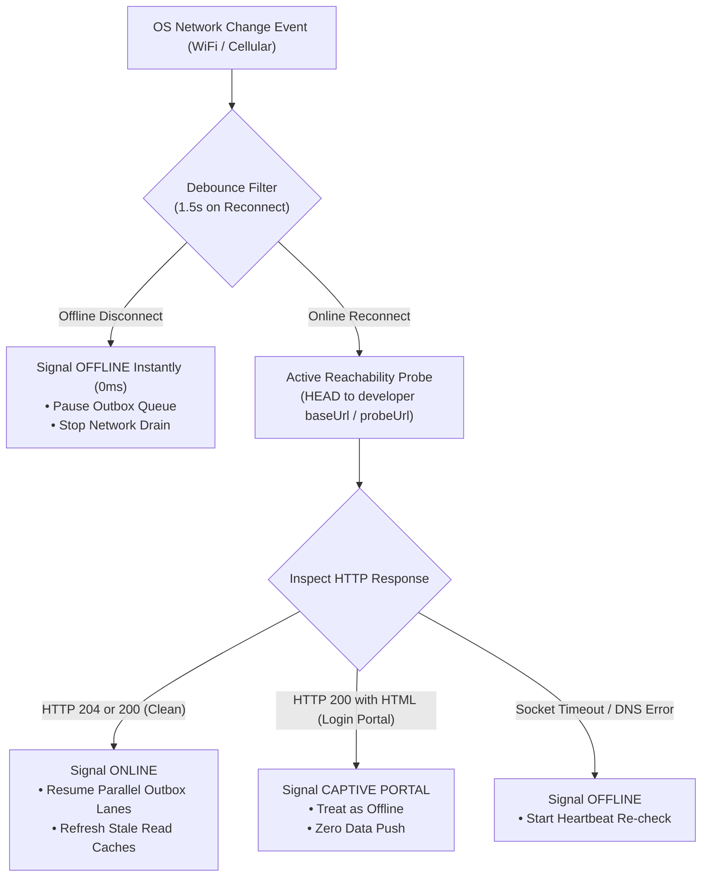
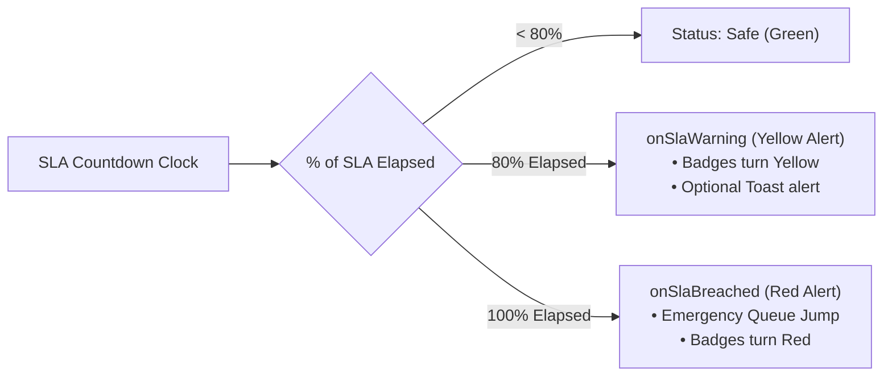

# 🛰️ Orbit Architecture Blueprint — Layers 2 & 4: Observability & Connectivity

> **Status:** APPROVED & LOCKED  
> **Target Package:** `orbit_sync`  
> **Role:** The Senses of Orbit (Network Sensing & Telemetry)  
> **Philosophy:** Real Reachability, Zero Memory Leaks, Auto-Pausing Streams, Actionable Developer Diagnostics

---

## 1. Executive Summary & Core Purpose

This document specifies the sensing and diagnostic layers of Orbit:
* **Layer 4 (Connectivity Sensing)**: Accurately detects whether the device has *genuine* internet access (eliminating "Fake WiFi" and captive portal deadlocks) without battery drain or network flapping.
* **Layer 2 (Observability & Sync Center)**: Provides a unified, memory-safe diagnostic API (`syncCenter`) so developers can build intuitive sync status panels and failure-resolution screens for their users.

---

## 2. Layer 4: Connectivity Sensing Architecture

A mobile phone can be connected to a WiFi router that has no internet access (e.g. coffee shop login page or subway station). If the sync engine tries to push data, requests will hang and fail.



### The 4 Foundational Guarantees of Layer 4:

1. **Zero Hardcoded Google URLs**:
   * Removed hardcoded `gstatic.com` probes.
   * Probes test the developer's configured **`baseUrl`** (e.g. `HEAD /api/v1/health` or `HEAD /`) or custom `probeUrl`.
2. **Asymmetric Flapping Protection (`DebouncePolicy`)**:
   * **Going Offline**: Signals `offline` **instantly** (0ms) so the app immediately stops making doomed HTTP calls.
   * **Going Online**: Waits **1.5 seconds** before signaling `online` to let cellular/WiFi radio handoffs stabilize.
3. **Captive Portal Isolation**:
   * Detects hotel/airport WiFi login pages.
   * If a probe returns HTML login content, Orbit flags `isCaptivePortal = true` and **refuses to send unencrypted user payloads**.
4. **Metered Connection Awareness**:
   * Detects whether the device is on Cellular vs. WiFi/Ethernet so large media attachments can be selectively deferred if configured.

---

## 3. Layer 2: The Unified Sync Center API (`orbit.syncCenter`)

Orbit **never** forces a pre-baked, rigid UI screen on the host app. 

Instead, Orbit processes all internal database complexity and exposes **one clean, ready-to-use diagnostic model**:

```dart
class SyncItemInfo {
  final String mutationId;
  final String entityName;         // e.g. "Order", "Payment"
  final String entityId;           // e.g. "ord_101"
  final SyncItemStatus status;     // pending, inFlight, synced, rejected, failed, held
  final String? failureReason;     // Human-readable server message (e.g. "Warehouse B is out of stock")
  final Duration? remainingSla;    // Time left before deadline (e.g. 14 minutes)
  final DateTime createdAt;        // Creation timestamp
  final Map<String, dynamic> data; // Original model data for display
  
  bool get canRetry => status == SyncItemStatus.rejected || status == SyncItemStatus.failed;
}
```

---

## 4. Memory-Safe, Auto-Pausing Stream Architecture

To prevent memory leaks, frame drops, and battery drain in Flutter:

```dart
abstract class OrbitSyncCenter {
  /// 1. Real-time Live Stream of processed outbox items
  Stream<List<SyncItemInfo>> watchItems({SyncItemStatus? filterStatus});

  /// 2. Real-time Live Summary (for App Bar pills and badges)
  ValueListenable<OrbitSummary> get summary;

  /// 3. Manual User Controls (1-Tap Actions)
  Future<void> syncNow();
  Future<void> retryItem(String mutationId);
  Future<void> retryAllFailed();
}
```

### The 3 Stream Performance Invariants:

1. **Auto-Pausing Lifecycle (`onListen` / `onCancel`)**:
   * When the user opens the Sync Center screen ➔ The stream activates and watches SQLite changes.
   * When the user closes the screen ➔ The stream **automatically sleeps**. Background database queries stop completely. **Zero memory leaks.**
2. **Microtask Coalescing (60/120 FPS UI Protection)**:
   * During heavy syncing (e.g. 50 mutations), emissions are throttled to a maximum frequency of **once every 100ms**.
   * Prevents Dart event-loop microtask flooding and keeps the Flutter UI buttery smooth.
3. **Push-Triggered Latency (0ms Delay)**:
   * When a state transition occurs in Storage B, an in-memory trigger fires immediately. 
   * Updates reach the developer's screen in sub-milliseconds without periodic polling loops.

---

## 5. Early-Warning SLA Alerts (`SlaMonitor`)

The background `SlaMonitor` scans Storage B every 30 seconds to alert users *before* deadlines are missed:



### Developer Alert Hooks (Layer 1 Integration):
```dart
final orbit = await OrbitClient.initialize(
  baseUrl: 'https://api.myerp.com',
  userId: 'usr_9842',
  
  onSlaWarning: (event) {
    // 80% SLA consumed: Show warning toast
    alerts.showToast('Warning: Order #${event.entityId} sync deadline in 15 mins!');
  },

  onSlaBreached: (event) {
    // 100% SLA breached: Show critical banner
    alerts.showBanner('🚨 Critical: Order #${event.entityId} has breached SLA!');
  },
);
```

---

## 6. Summary of Layers 2 & 4 Guarantees

| Property | Rule |
| :--- | :--- |
| **Reachability** | Probes the developer's `baseUrl` or `probeUrl`. Zero hardcoded Google dependencies. |
| **Flapping** | 0ms instant offline signal; 1.5s debounced online signal. |
| **Captive Portals** | Detected via HTML payloads; isolates user data from unencrypted portals. |
| **Memory Safety** | `onListen`/`onCancel` auto-pauses streams when UI screens close. |
| **UI Performance** | 100ms microtask throttling guarantees zero dropped UI frames. |
| **Developer Autonomy**| Orbit passes clean `SyncItemInfo` data; host developers design their own custom UI screens. |
